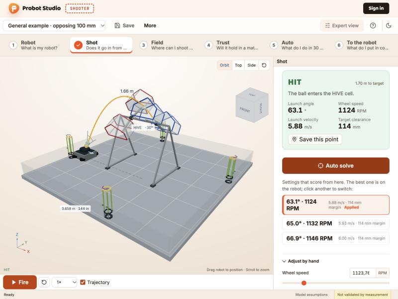

# Probot Shooter: POLLEN shot simulator for FTC BIOBUZZ

[](https://github.com/efeerdogmus0/ftc-biobuzz-shooter-calculator/actions/workflows/ci.yml)
[](https://github.com/efeerdogmus0/ftc-biobuzz-shooter-calculator/actions/workflows/pages.yml)

A browser simulator for designing and tuning a flywheel shooter for the FTC
2026–27 game BIOBUZZ. You describe your shooter (wheels, hood, compression, exit
height), place the robot on a 3D field, and the app works out whether the
POLLEN ball goes into the HIVE from there, which wheel speed and launch angle to
use, how sensitive the shot is to error, and what lookup table to put in your
robot code.

**Live demo:** https://efeerdogmus0.github.io/ftc-biobuzz-shooter-calculator/
(static build, runs entirely in the browser; no account or backend).



## What it does

- **Launch model.** Ball–wheel contact is integrated step by step with Coulomb
  friction, compression-based normal force and finite wheel inertia, so exit
  speed, exit spin and flywheel RPM drop come out of the same calculation. Main
  wheel plus powered or fixed hood rollers, and two opposed wheels, are
  supported.
- **Flight.** Drag, Magnus lift from the computed spin, spin decay and wind;
  the perforated POLLEN shell has its own inertia tensor.
- **Field and target.** HIVE and CELL geometry from the official BIOBUZZ field
  drawings, with a hit test that requires the whole ball to pass through the
  CELL opening.
- **Solving and analysis.** Auto solve for angle and RPM, a clickable
  field-coverage heatmap, a shot-angle study, Monte Carlo consistency
  (100 to 10,000 seeded trials) and shooter clearance checks. Heavy work runs in
  cancellable web workers.
- **Bounce lab.** Optional rigid or Hertz contact simulation of the ball
  hitting the CELL, resident balls and the hinged, tipping HIVE.
- **To the robot.** Exports a shot table as CSV, a small FTC Java class
  (constants plus clamped linear lookup) or a printable sheet. Shots logged on
  the real robot are replayed in the simulation next to the real outcome, and a
  calibration step fits the launch model on part of the measured rows and
  checks it on the rest.
- **Guided view.** Six steps (Robot, Shot, Field, Trust, Auto, To the robot)
  lead from "what is my robot?" to "what goes in my code?". The full
  engineering workbench is one click away as Expert view. Interface in English
  and Turkish.

The [user guide](docs/USER_GUIDE.md) walks through every panel.

## Run locally

Requires Node.js 22.12+ and npm.

```sh
npm ci
npm run dev        # http://localhost:5173
```

Checks (the same ones CI runs before every deploy):

```sh
npm run typecheck
npm run lint
npm run format:check
npm run test:ci    # full unit suite, test files run one at a time
npm run build      # static site in dist/
npm run test:e2e   # optional Playwright browser tests
```

Profiles are saved in the browser's localStorage and can be exported as JSON or
shared as a link (the state is encoded in the URL hash).

## Physics model and its limits

The equations, numerical method and every assumption are written up in
[docs/PHYSICS.md](docs/PHYSICS.md), with the moving HIVE and the perforated
ball in [docs/HIVE_AND_POLLEN.md](docs/HIVE_AND_POLLEN.md). In short:

- All internal state is SI. The shooter contact uses an accumulated-impulse
  solver with a Coulomb limit per time step; contact ends at the end of the hood
  arc, and a ball that does not get through is reported as `NO EXIT` instead of
  being launched anyway.
- Every tool (preview, auto solve, coverage, Monte Carlo, calibration, angle
  study, clearance) uses the same ball model, so their numbers agree with each
  other.
- Flight is integrated with an adaptive Dormand–Prince RK5(4) method, and the
  CELL hit test uses continuous collision detection against the pentagonal
  opening and walls.
- A reference mode is fitted to the outputs of the ReCalc flywheel calculator
  for one reference shooter (7.585 m/s exit speed, its RPM drop, spin-up and
  recovery times). It is an empirical anchor, not a reimplementation of ReCalc.

What the model is **not**:

- **It is not calibrated against a real robot.** Wheel and ball friction,
  stiffness, restitution and aerodynamic coefficients are engineering
  assumptions until you measure them. The app labels results "Simulation · not
  measured on the robot" until a calibration with held-out measured shots
  passes.
- **Passing tests means the code is internally consistent,** not that it
  predicts real shots. Before trusting the numbers you still need measured
  POLLEN mass and diameter, motor speed under load, hood geometry and
  compression, and a set of logged shots for the calibration step.
- A "HIT" means the ball enters the CELL opening before touching a solid. It
  does not certify that the ball stays in or that it scores under the official
  rules. Ball deformation, airflow through the shell's holes and FLOWER
  collisions are not modelled.

## Tests

292 unit tests in 27 files (Vitest) cover the physics and the tools built on
it: impulse and energy bookkeeping in the shooter contact, integrator
convergence, CELL geometry and whole-ball entry, Magnus direction, `NO EXIT`
handling, auto-solve candidates re-checked by full simulation, reproducible
Monte Carlo runs,
calibration train/validation splits, the moving HIVE, shot table and Java
export, share links, profile migration and the guided-view state. The auto
planner has its own tests that run only when the Probot Sim code is present.

CI runs typecheck, lint, format check, the whole suite and a production build
on every push and pull request. The Pages workflow repeats the same checks
before it builds, so the live demo is never deployed from failing code.

## Project layout

- `src/physics`: contact, flight, aerodynamics, collision, solver, calibration,
  Monte Carlo and bounce. Pure TypeScript, no React or Three.js.
- `src/field`: field and HIVE geometry with references to the official
  drawings.
- `src/export`: shot table, Java export and shot log.
- `src/workers`: background analysis, preview, calibration, export.
- `src/scene`, `src/components`: Three.js scene and the interface.
- `src/i18n`: English/Turkish dictionary.
- `src/tests`: unit and regression tests.

## Auto planner

Step 5 (Auto) plans a 30-second autonomous route for your robot. It reuses path
and drive code from Probot Sim, a separate project by Tuna Gül that is not
public, so it is only present in local builds that have that code
(`npm run probot:sync`, see [docs/AUTO_PLANNER.md](docs/AUTO_PLANNER.md)). The
public demo shows "The auto planner is not in this build" for that step.

## Credits

- Field geometry: FIRST Tech Challenge BIOBUZZ game manual and field drawings
  (consulted 2026-09-14). The official CAD is the authority.
- Shooter clearance, the angle study and the 2025 DECODE reference data were
  adapted from Tuna Gül's contribution for FTC team #25577 Zağanos
  ([PR #1](https://github.com/efeerdogmus0/ftc-biobuzz-shooter-calculator/pull/1),
  details in [docs/TUNA_CONTRIBUTIONS.md](docs/TUNA_CONTRIBUTIONS.md)).
- Reference values from the ReCalc flywheel calculator.

## License

[MIT](LICENSE). The Probot Sim code used by the auto planner is not part of this
repository and is not covered by this license.
